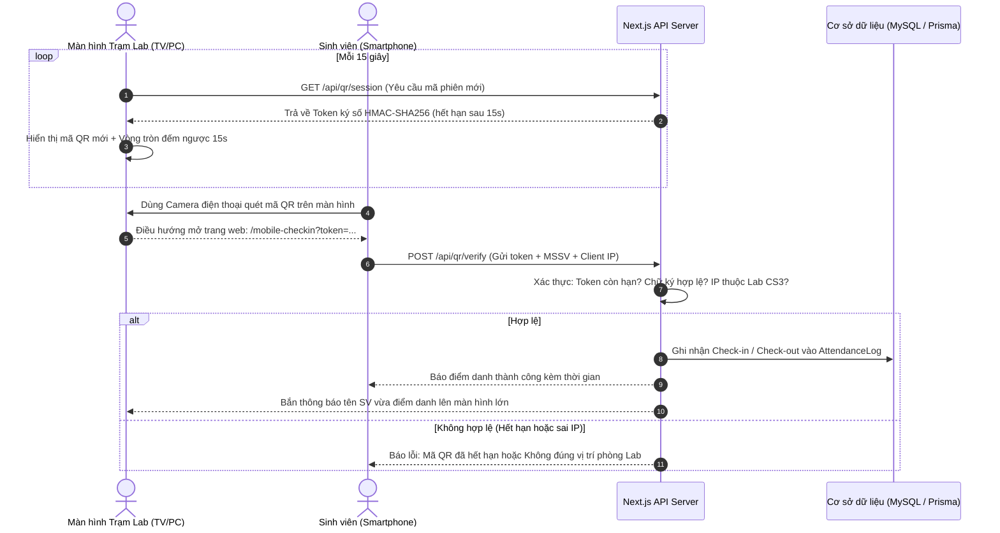

# KẾ HOẠCH CHI TIẾT TRIỂN KHAI HỆ THỐNG ĐIỂM DANH BẰNG MÃ QR ĐỘNG (DYNAMIC QR CODE)
**Đề tài:** Hệ thống Quản lý & Điểm danh Phòng LAB bằng Barcode & Dynamic QR Code  
**Đơn vị:** Khoa Công nghệ Thông tin – Trường Đại học Văn Lang  
**Phòng thực hành:** Phòng 5.18 - Lầu 5, Tòa A (Cơ sở chính)  
**Giảng viên hướng dẫn:** ThS. Lý Thị Huyền Châu  

---

## I. TỔNG QUAN GIẢI PHÁP (MÔ HÌNH 2)

### 1. Khái niệm Mô hình 2 (Station-Projected Dynamic QR Code & Mobile Check-in)
Hệ thống hiển thị một **Mã QR động (Dynamic QR Code)** liên tục trên màn hình máy tính Trạm Lab hoặc màn hình TV phòng máy 5.18. Sinh viên khi bước vào phòng Lab chỉ cần mở Camera điện thoại di động (hoặc app quét mã bất kỳ) để quét mã QR và xác nhận điểm danh.

### 2. Ưu điểm nổi bật so với quét thẻ truyền thống
* **Giải quyết triệt để ùn tắc đầu ca trực:** Khi 30 – 45 sinh viên cùng vào phòng máy, không cần phải xếp hàng từng người trước 1 mắt đọc barcode duy nhất. Nhiều sinh viên có thể đồng thời quét mã trên màn hình lớn từ khoảng cách 2 – 5 mét.
* **Không cần mang thẻ vật lý:** Tránh trường hợp sinh viên quên thẻ SV, rơi thẻ hoặc hỏng mã vạch thẻ cứng.
* **Công nghệ hiện đại & Thân thiện:** Sử dụng chính smartphone của sinh viên mà không cần cài đặt thêm app native cồng kềnh (hoạt động 100% trên nền tảng Web di động - Progressive Web App).

---

## II. KIẾN TRÚC HỆ THỐNG & CƠ CHẾ BẢO MẬT CHỐNG GIAN LẬN

### 1. Sơ đồ Luồng hoạt động (Workflow Diagram)

---

### 2. Cơ chế Chống gian lận 3 Lớp (3-Layer Anti-Cheat Mechanism)

| Lớp bảo mật | Tên cơ chế | Nguyên lý hoạt động | Ngăn chặn hành vi gian lận |
| :--- | :--- | :--- | :--- |
| **Lớp 1** | **Dynamic Token TTL (15 giây)** | Mã QR được tạo ra cùng một Token có gắn `timestamp` và chỉ tồn tại trong đúng 15 giây. Sau 15s, token này bị hủy trên server. | Ngăn sinh viên chụp ảnh mã QR gửi qua Zalo/Messenger cho bạn ở ngoài trường điểm danh hộ. |
| **Lớp 2** | **Ký số bảo mật (HMAC-SHA256)** | Dữ liệu mã QR mang chuỗi payload có chữ ký mã hóa bằng khóa bí mật (`JWT_SECRET`). | Ngăn sinh viên tự ý chỉnh sửa URL hoặc giả mạo token hợp lệ. |
| **Lớp 3** | **Kiểm tra Wi-Fi / IP Mạng Lab (Subnet Verification)** | Server kiểm tra địa chỉ IP truy cập của điện thoại SV, chỉ chấp nhận dải IP mạng trường / Wi-Fi phòng Lab 5.18. | Ngăn sinh viên ngồi ở nhà hoặc quán cafe quét mã (dù có lấy được token cũng không thể điểm danh qua 4G/mạng ngoài). |

---

## III. CÔNG NGHỆ ÁP DỤNG (TECH STACK)

1. **Frontend Hiển thị & Tạo mã QR:**
   * Thư viện `qrcode.react`: Render mã QR động chuẩn SVG siêu nét, hiển thị tối ưu trên màn hình độ phân giải cao hoặc máy chiếu/TV phòng Lab.
   * CSS Animation / Framer Motion: Hiệu ứng đếm ngược 15 giây (Circular Countdown Progress) tạo trải nghiệm công nghệ cao.
2. **Frontend Di động (Mobile Web Interface):**
   * Giao diện tối ưu Mobile-first, responsive trên mọi kích thước màn hình điện thoại (iOS Safari, Android Chrome).
   * Tự động lưu trữ thông tin sinh viên vào `localStorage` sau lần đầu để các ca sau chỉ cần 1 chạm xác nhận.
3. **Backend API & Database:**
   * **Next.js Route Handlers:**
     - `GET /api/qr/session`: Cấp phát token mã QR động.
     - `POST /api/qr/verify`: Xác thực token và xử lý điểm danh (Check-in/Check-out).
     - `GET /api/qr/live-feed`: Cung cấp danh sách sinh viên vừa quét theo thời gian thực.
   * **Prisma ORM & MySQL:** Tận dụng bảng `AttendanceLog`, `LabRoom`, `User` hiện có, đảm bảo đồng bộ 100% dữ liệu với máy quét Barcode.

---

## IV. LỘ TRÌNH THỰC HIỆN CHI TIẾT (4 GIAI ĐOẠN)

### Giai đoạn 1: Xây dựng Backend API & Thuật toán Token Động (Ngày 1)
- [ ] Xây dựng tiện ích tạo và giải mã token có ký số HMAC (`lib/qr-security.ts`).
- [ ] Xây dựng Endpoint API `GET /api/qr/session` cấp token QR mỗi 15 giây.
- [ ] Xây dựng Endpoint API `POST /api/qr/verify` xác thực và ghi log điểm danh.
- [ ] Tích hợp cơ chế kiểm tra dải IP phòng Lab CS3 / Mạng trường Văn Lang.

### Giai đoạn 2: Xây dựng Màn hình Chiếu QR Động tại Phòng Lab (Ngày 2)
- [ ] Thiết kế trang `/qr-station`: Màn hình hiển thị mã QR kích thước lớn, thông tin phòng `Phòng 5.18 - Lầu 5, Tòa A (Cơ sở chính)`.
- [ ] Tích hợp thanh đồng hồ thời gian thực và vòng tròn đếm ngược 15 giây chuyển động mượt mà.
- [ ] Thêm khung hiển thị "Danh sách vừa quét thành công" trực tiếp trên màn hình chiếu để SV biết mình đã được ghi nhận.

### Giai đoạn 3: Xây dựng Trang Điểm danh trên Điện thoại Di động (Ngày 3)
- [ ] Thiết kế trang `/mobile-checkin` giao diện Light Mode tinh gọn, thân thiện với màn hình dọc.
- [ ] Hiển thị thông tin sinh viên, ca trực, nút "Xác nhận Điểm Danh Ngay".
- [ ] Xử lý phản hồi trực quan: Phát âm thanh chime thành công, thông báo giờ vào/ra rõ ràng.

### Giai đoạn 4: Tích hợp Hệ thống, Kiểm thử & Đóng gói Báo cáo (Ngày 4)
- [ ] Thêm liên kết truy cập nhanh phân hệ QR Code trên Trang chủ (`app/page.tsx`).
- [ ] Kiểm thử luồng quét thực tế giữa Máy tính (Trạm phát QR) và Điện thoại di động.
- [ ] Kiểm thử các trường hợp ngoại lệ: Token hết hạn, quét ngoài mạng Lab, quét trùng lặp trong ca trực.
- [ ] Cập nhật tài liệu kỹ thuật và file `README.md` phục vụ báo cáo với GVHD ThS. Lý Thị Huyền Châu.

---

## V. ĐÁNH GIÁ ĐÓNG GÓP CHO ĐỀ TÀI
1. **Tính toàn diện:** Đề tài sở hữu trọn vẹn 2 giải pháp công nghệ song song:
   - **Barcode 1D:** Quét thẻ nhựa vật lý và quản lý tài sản/thiết bị phòng Lab.
   - **Dynamic QR Code:** Điểm danh sinh viên thông minh không chạm qua smartphone.
2. **Tính ứng dụng thực tế:** Giải pháp có thể triển khai ngay tại Phòng 5.18 Tòa A Cơ sở chính Đại học Văn Lang mà không phát sinh thêm chi phí phần cứng chuyên dụng.
